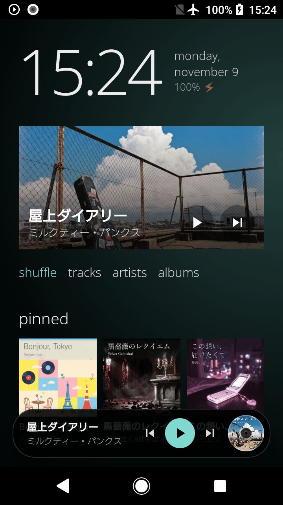
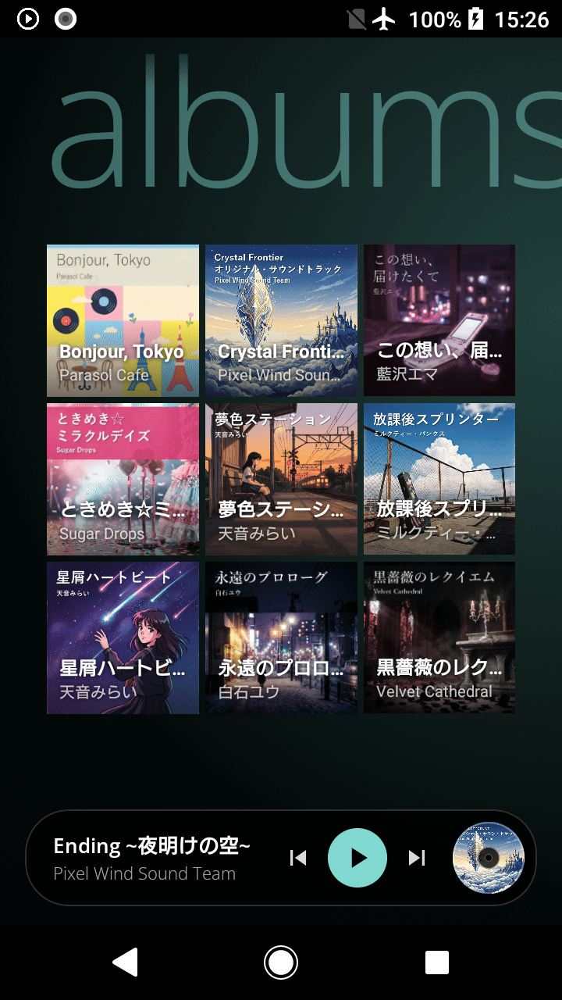
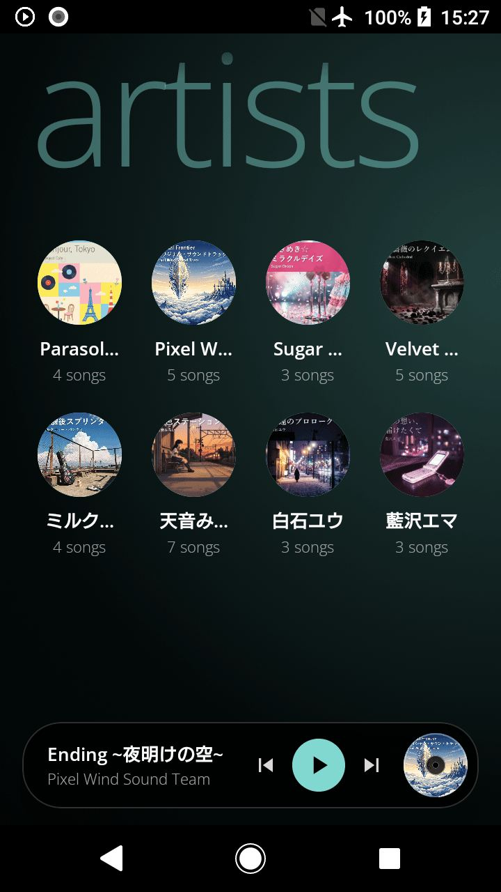
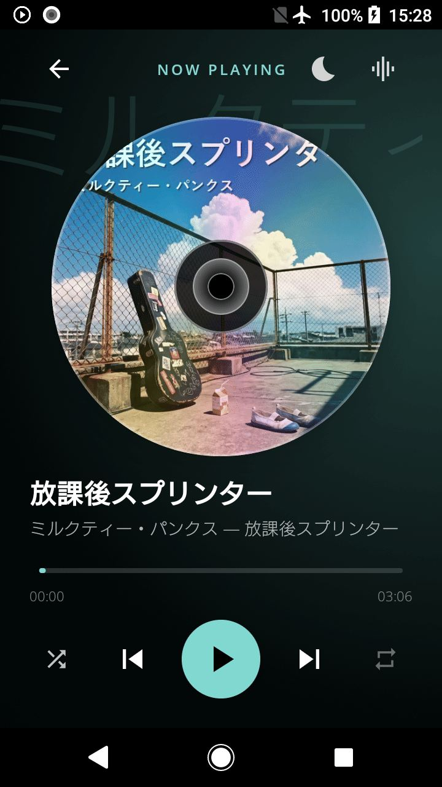

  

<h1 align="center">Mataoto (また音)</h1>

  Turn an old Android phone into a music player worth looking at. 
  古い Android を、眺めて楽しい音楽専用機に。

  <strong>Free · No ads · No network access · Android 5.0+ · 2.6 MB · Beta</strong>

  <a href="https://github.com/drawerdev/mataoto/releases/latest"><strong>Download APK</strong></a>
  &nbsp;·&nbsp;
  <a href="https://mataoto.netlify.app/en/"><strong>Website</strong></a>
  &nbsp;·&nbsp;
  <a href="#日本語"><strong>日本語</strong></a>

  
  
  
  

  The songs, artists and covers shown are fictional and made for this demo. The covers were made with AI.

---

## English

Plays the music files already on your phone. Big type slides sideways across panorama pages, and it can replace the home screen. Sleep timer, resume, lock screen player, quiet mode, headphones only, pins, accent colors, equalizer. No streaming, bit-perfect USB DAC output or DSD.

### Is it safe?

The source code is not public, so here is what you can check yourself.

- **No INTERNET permission:** Android does not let the app go online. See [the report](https://www.virustotal.com/gui/file/451d79752ddcdc96b3f267846683409ffc1e8b98ae1d6ffca9b4400fd13c0444), DETAILS → Permissions ("Show 5 more").
- **Virus scan:** 0 of 68 vendors flagged this APK on 2026-11-09 ([report](https://www.virustotal.com/gui/file/451d79752ddcdc96b3f267846683409ffc1e8b98ae1d6ffca9b4400fd13c0444)).
- **No ads, analytics or accounts.**

| | SHA-256 |
|---|---|
| APK | `451d79752ddcdc96b3f267846683409ffc1e8b98ae1d6ffca9b4400fd13c0444` |
| Signing certificate (same for every version) | `75c9bbd7733633dfb4e1f49ad822455416d1af53c8550d6bfe03525d5ac3848e` |

I can't promise it is perfectly safe. If you're worried, use a phone with Wi-Fi off, or one with nothing important on it.

### Install

Get the APK from [Releases](https://github.com/drawerdev/mataoto/releases/latest) and follow the [steps on the website](https://mataoto.netlify.app/en/#install). Android 5.0 or later; tested on real phones from Android 5.1 to 17. On Android 7.0 and earlier, GitHub may show a certificate warning, so use https://mataoto.netlify.app/ instead. Releases and that website are the only official sources.

### More

Reports: [Issues](https://github.com/drawerdev/mataoto/issues) or the [form](https://docs.google.com/forms/d/e/1FAIpQLSf_zoyWq96qTkPaVP3LHtkUCGloQqXUa2P9kBcE_pbT9mfy3Q/viewform) (one-person project, replies usually on weekends). Free to use; please do not modify or redistribute it. By drawerdev · [Official accounts](https://mataoto.netlify.app/en/#official) · [Support](https://ofuse.me/drawerdev) (optional, changes nothing in the app).

---

## 日本語

端末に入っている音楽ファイルを再生するプレイヤーです。大きな文字が横に流れるパノラマ画面で、ホーム画面ごと音楽専用にもできます。スリープタイマー、前回の続きから再生、ロック画面の再生画面、quiet mode、headphones only、ピン留め、アクセントカラー、イコライザー。ストリーミング再生、USB DAC への直接出力、DSD はできません。

### 安全ですか？

ソースコードは公開していません。代わりに、次のことを自分で確かめられます。

- **インターネット権限がありません:** Android の仕組みとして、アプリは通信できません。[VirusTotal の結果](https://www.virustotal.com/gui/file/451d79752ddcdc96b3f267846683409ffc1e8b98ae1d6ffca9b4400fd13c0444)の DETAILS → Permissions で一覧を見られます（「Show 5 more」で全部出ます）。
- **ウイルスチェック:** 2026-11-09 の時点で、68 社すべて検出なしでした（[結果](https://www.virustotal.com/gui/file/451d79752ddcdc96b3f267846683409ffc1e8b98ae1d6ffca9b4400fd13c0444)）。
- **広告・解析・アカウント登録はありません。** APK と署名証明書の SHA-256 は上の表のとおりです。

それでも「絶対に安全」とは言い切れません。心配な方は、Wi-Fi を切った端末や、大事なデータの入っていない端末でお使いください。

### 入れ方

[Releases](https://github.com/drawerdev/mataoto/releases/latest) から APK を入手して、[Web サイトの手順](https://mataoto.netlify.app/#install)のとおりに入れてください。Android 5.0 以上。Android 5.1〜17 の実機で確かめました。Android 7.0 以下では GitHub で証明書の警告が出ることがあるので、https://mataoto.netlify.app/ を使ってください。公式の入手先は、ここの Releases とこの Web サイトだけです。

### そのほか

報告は [Issues](https://github.com/drawerdev/mataoto/issues) か[フォーム](https://docs.google.com/forms/d/e/1FAIpQLSf_zoyWq96qTkPaVP3LHtkUCGloQqXUa2P9kBcE_pbT9mfy3Q/viewform)へ（一人で作っているので、返事は週末が多いです）。無料で使えます。改変・再配布はご遠慮ください。作者: drawerdev ・ [公式のアカウント](https://mataoto.netlify.app/#official) ・ [応援](https://ofuse.me/drawerdev)（任意。アプリの機能は変わりません）
